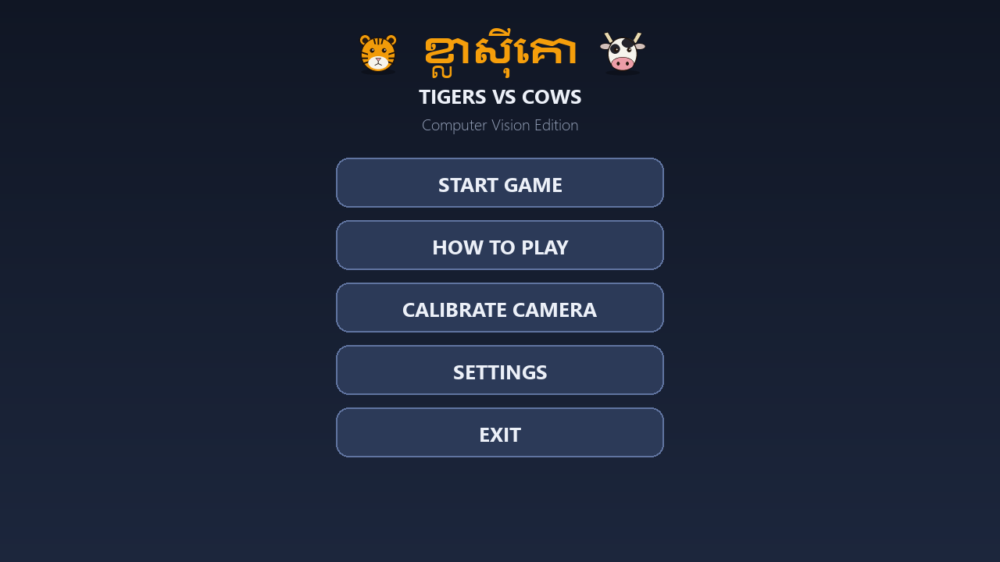
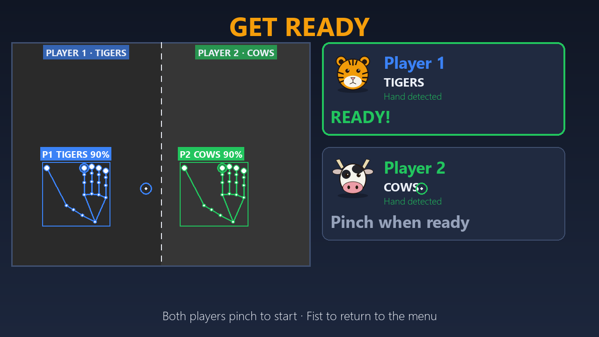
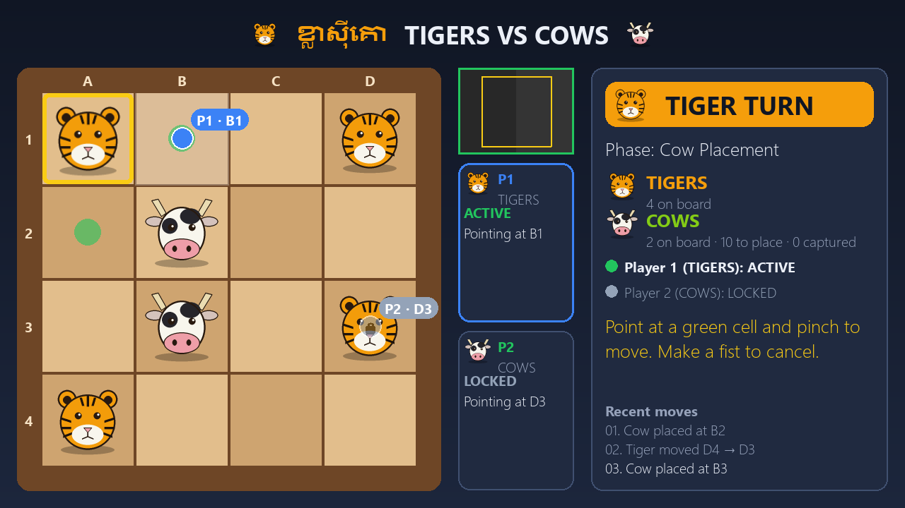
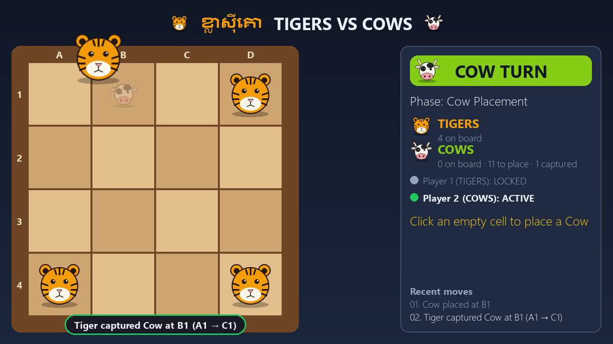
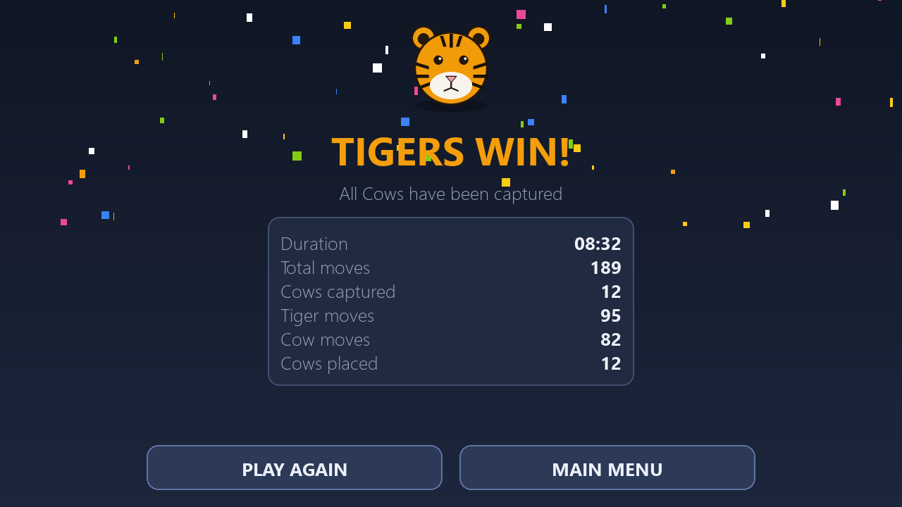
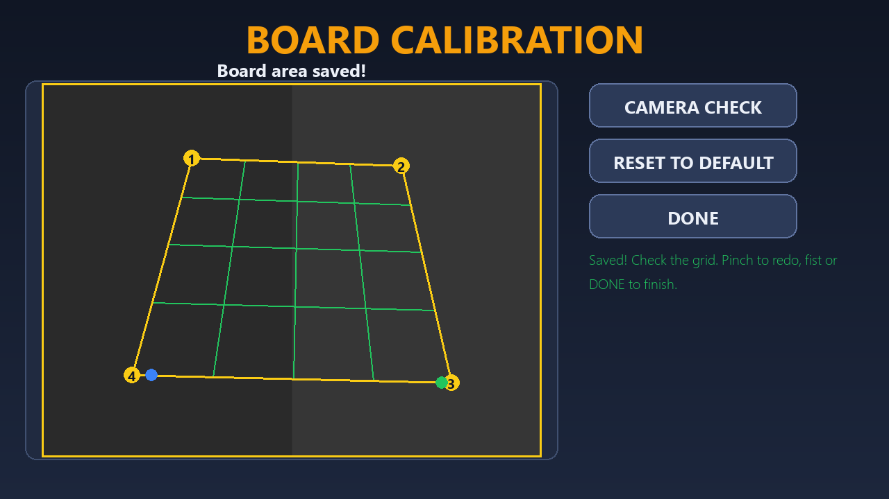
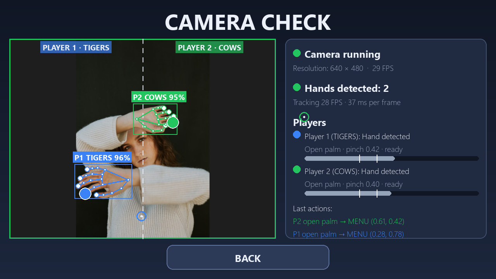
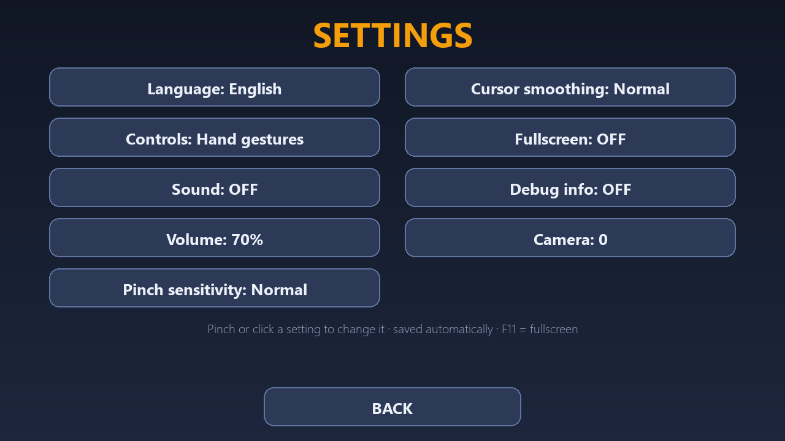
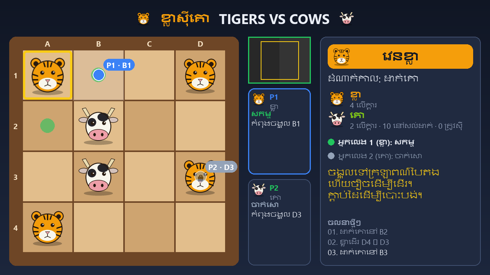

# User guide

How to play ខ្លាស៊ីគោ, Tigers vs Cows, with your hands. For the rules of the game itself, see
[Game rules](GAME_RULES.md). For setting up, see [Installation](INSTALLATION.md).

## The four gestures

| Gesture | How | Does |
| --- | --- | --- |
| ☝️ **Point** | Index finger out | Moves your cursor; the cell under it lights up |
| 🤏 **Pinch** | Touch thumb and index fingertips, **hold ¼ second** | Select / place / move / press a button |
| ✊ **Fist** | Close your hand, hold ½ second | Cancel the selection · go back · resume from pause |
| ✋ **Open palm** | All fingers straight, thumb spread out, hold still 1.5 seconds | Pause the game |

**One pinch = one action.** Holding a pinch longer never repeats it; open your fingers and pinch again for the
next action. A quick accidental touch (shorter than ¼ second) does nothing. After each action there is a
½-second pause before the next one counts.

Tips for reliable pinches:

- Point first, **hold still for a moment, then pinch**. The game uses where you were pointing just before your
  fingers closed, so the small movement of pinching does not move you to the wrong cell.
- Keep your hand facing the camera, fingers visible, not too close (about 1–1.5 m from the camera works well).
- If pinches are missed or fire too easily, change **Pinch sensitivity** in Settings (see below).

## Who is who

| | Player 1 | Player 2 |
| --- | --- | --- |
| Plays | 🐯 Tigers | 🐄 Cows (goes first) |
| Stands | on the **left** of the camera picture | on the **right** |
| Cursor | 🔵 blue | 🟢 green |

The game recognises players by where their hand **first appears**. After that it follows each hand, so you
may reach across the middle to point anywhere on the board and you stay the same player. If your hand
disappears for a moment, the game keeps your place for about half a second (*"Hand lost"*). Use **one hand per
player**; a second hand on your side is ignored (shown grey as *"extra hand"*).

### Playing alone against the computer

Set **Computer opponent** in Settings to **Easy**, **Normal** or **Hard**, and choose your side with **You play**
(Tigers or Cows). Every gesture works with one hand, so this is also the way to play if you have the use of only one
hand.

- Stand anywhere; there are no left/right zones. On the ready check, **one pinch** starts the game.
- Any hand you show plays your side. On the computer's turn, the side panel says *"Computer is thinking..."*. It
  then picks up its piece and moves it a moment later, so you can see what it did.
- Pause (open palm), cancel (fist) and the mouse work as usual. The results screen says whether you or the computer
  won.
- **Easy** makes deliberate mistakes; **Hard** looks four turns ahead.

### Playing both sides with one hand

Turn on **One-hand play** in Settings (and leave **Computer opponent** off) to play both sides yourself with a single
hand:

- Stand anywhere; there are no left/right zones. On the ready check, **one pinch** starts the game.
- Your hand always gets the bright cursor and plays for whichever side's turn it is: place a Cow, then move a
  Tiger, then the next Cow, and so on.
- Fist cancels a selection, and an open palm held still pauses, as usual.
- Keep only one hand in view. If a second hand appears, it can act too.

## Screens and flow

```text
Main menu → Ready check → Game → Game over → Play again (ready check) or Main menu
```



On the menu, and on every screen except the board, the **whole camera picture maps onto the whole window**.
Point to move your ring-shaped pointer onto a button and pinch it.

| Button | Opens |
| --- | --- |
| START GAME | The ready check (the game directly when using the mouse) |
| HOW TO PLAY | A summary of the controls and rules |
| CALIBRATE CAMERA | Choose your pointing area; also has CAMERA CHECK |
| SETTINGS | Language, controls, sound, sensitivity… |
| EXIT | Quit (a fist on the menu never quits, only this button or ESC) |

### Ready check



Both players see themselves in their half of the picture. Each player **pinches once** to say READY. When both
are ready: **3 · 2 · 1 · GAME START!** A fist returns to the menu.

### Playing



| Part of the screen | Shows |
| --- | --- |
| Board (left) | Pieces, your cursor with the cell name (e.g. `P1 · B1`), the selected piece (gold border) and where it can go (green dots) |
| Camera column (middle) | Live thumbnail with the **pointing area** outlined in yellow, and a card per player: ACTIVE or LOCKED, and what they point at |
| Side panel (right) | Whose turn, phase, piece counts, a hint for what to do now, and the recent moves |

Only the player whose turn it is can act; their cursor is bright. The other player's cursor is grey with a
padlock, and if they pinch, nothing happens except a message like *"P1: It is not your turn"*.

After every pinch on the board, the cell **flashes green** (it worked) or **red** (it did not, with the reason
below the board). Moves are animated: a placed Cow drops in, pieces slide, and a capturing Tiger jumps over
the Cow.

| To… | Do |
| --- | --- |
| Place a Cow (Cow placement phase) | Point at an empty cell, pinch |
| Move a piece | Pinch your piece → green dots appear → pinch a green cell |
| Change your mind | Pinch another of your pieces, pinch the same piece again, or make a fist |
| Capture (Tiger) | Select the Tiger, pinch the green dot beyond the Cow |



### Pausing

Hold a spread **open palm** (thumb out) still for 1.5 seconds (either player), or press **ESC**. On the pause screen, pinch **RESUME** or
**MAIN MENU**, or make a fist (or press ESC again) to resume.

### Game over



*(Screenshot from a simulated game; the duration was set for illustration.)*

The winner, the reason and the statistics. Pinch **PLAY AGAIN** (goes to the ready check) or **MAIN MENU**.

## Calibrating the board area

There is no physical board: you choose **a square in the air in front of the camera that maps onto the on-screen
board**. Choose one that both players can reach comfortably without stretching.

1. Main menu → **CALIBRATE CAMERA**.
2. Your fingertips appear as coloured dots on the camera picture.
3. Pinch the four corners in order: **top-left → top-right → bottom-right → bottom-left**.
4. The 4 × 4 grid appears in green. Check that it covers a comfortable area.
5. Make a fist or click **DONE**. To redo it, just pinch again.



The area is saved and used every time you start the game. A tilted area is fine. If the corners are in the wrong
order or the square is too small, a red message asks you to start again. **RESET TO DEFAULT** returns to the
original area (the middle of the camera picture).

The **CAMERA CHECK** button on this screen shows detailed hand tracking, useful for testing:



*(Shown with MediaPipe's public sample photo.)*

It shows the players' zones, each hand's skeleton, each player's gesture, and a **pinch meter**: the bar is the
current thumb–index distance and the two white lines are the "pinched" and "released" thresholds. Green means
pinched. A relaxed open hand should sit to the right of both lines. The *Last actions* list shows every
recognised gesture.

## Settings



Pinch (or click) a setting to switch to its next value. Changes apply immediately and are remembered.

| Setting | Choices | Notes |
| --- | --- | --- |
| Language | English / ខ្មែរ | The whole interface, including move history and messages |
| Controls | Hand gestures / Mouse | Mouse mode turns the camera off (except while calibrating) |
| One-hand play | On / Off | One person plays both sides with one hand (see *Playing both sides with one hand*) |
| Computer opponent | Off / Easy / Normal / Hard | Play alone against the computer (see *Playing alone against the computer*) |
| You play | Tigers / Cows | Your side against the computer |
| Sound | On / Off | |
| Volume | 0 · 25 · 50 · 75 · 100 % | |
| Pinch sensitivity | Low / Normal / High | **High** = pinches register more easily; **Low** = stricter |
| Cursor smoothing | Low / Normal / High | **High** = steadier but slightly slower cursor |
| Fullscreen | On / Off | Also **F11** |
| Debug info | On / Off | Frame rate and hand skeletons in the camera thumbnail |
| Camera | 0 / 1 / 2 | For computers with more than one webcam |



## Playing with the mouse

Choose **Controls: Mouse** in Settings, or start with `python main.py --input mouse`. The mouse plays for whoever's
turn it is (hot-seat):

| Mouse / key | Does |
| --- | --- |
| Left-click | Same as a pinch |
| Right-click | Same as a fist (cancel / resume) |
| ESC | Pause / resume in a game; back elsewhere; quit from the menu |
| F11 | Fullscreen on/off |

The mouse also works in gesture mode, as a fallback.

## Command-line options

| Command | Effect |
| --- | --- |
| `python main.py` | Start the game |
| `python main.py --check` | Check Python, packages, hand model and camera |
| `python main.py --download-model` | Download the hand-tracking model (once, ~7.8 MB) |
| `python main.py --input mouse` / `--input gesture` | Controls for this session |
| `python main.py --mute` | No sound for this session |
| `python main.py --fullscreen` | Fullscreen for this session |
| `python main.py --debug` / `--no-debug` | Debug info for this session |

Command-line options apply to that session only; they never change your saved settings.
